# Reverse Engineering: "Mini LLM Sentinel" Crackme (crackme03)
## Sample Identification & Metadata
* **Challenge Title:** kamil123's Mini LLM Sentinel (Crackme #3)
* **Original File Name:** `crackme03.exe`
* **File Type:** PE32+ executable (Console), x86-64, statically linked
* **File Size:** ~467.50 KiB (478,720 bytes)
* **Platform / Arch:** Windows, x86-64 (AMD64)
* **Language:** C/C++
* **Declared Difficulty / Quality:** 6.0 / 5.0 (challenge site rating)
* **Author:** kamil123
* **Solver** DeepDominance
* **Goal:** Make the program print `[+] ACCESS GRANTED - you beat the LLM sentinel. Well done!` by entering the correct password (max. 5 attempts).
* **Toolchain:** Detect It Easy (DIE) v3.10, PE-bear, IDA Pro, Z3 (python `z3-solver`), Python 3
* **Archive Password:** `patched`

---

## Executive Summary

This write-up documents the reverse engineering of a Windows console crackme that gates a success message behind a password check. The twist is that the password validator is not a simple string comparison: the binary embeds a tiny, hand-rolled feed-forward neural network ("LLM sentinel") whose output is combined with classic checks (prefix, suffix, character-class table, and a byte checksum) to decide whether the input is accepted. In parallel, a background monitor thread polls a global flag and reacts to anti-analysis conditions by invoking a "sentinel verdict" routine that can terminate the process with a hostile-environment message.

The binary was triaged statically (DIE, PE-bear), the string table was mined for the program's logic hints and all user-facing messages, and the core validation and monitor-thread logic was reconstructed in IDA Pro. The password-check predicate was reduced to a closed set of integer/byte constraints and solved with Z3, and the full "LLM" scoring function (weights, permutation, classifier table, and XOR-obfuscated prefix/suffix constants) was reimplemented in Python directly from the executable's `.rdata` section to independently confirm the solution offline. Two single-byte-opcode patches were additionally identified and applied to neutralize the anti-debug/sentinel interruption path during live debugging.

---

## Binary Technical Specifications
* **Architecture:** PE32+ (64-bit Executable), Console subsystem
* **Imports:** `KERNEL32.dll` (44 functions), `msvcrt.dll` (49 functions), plus `advapi32.dll` / `kernelbase.dll` references
* **Sections:** `.text`, `.data`, `.rdata`, `.pdata`, `.xdata`, `.bss`, `.idata`, `.tls`, `.reloc`
* **Heuristic flags (DIE):** "(Heur)Packer: Compressed or packed data — High entropy + Section 2 (`.rdata`) compressed" — a false-positive triggered by the dense, random-looking neural-network weight/permutation tables stored in `.rdata`, not an actual packer stub.

---

## Technical Walkthrough

### 1. Static Triage (Detect It Easy)
Initial identification with **Detect It Easy v3.10** confirmed a native PE64 console binary (AMD64, little-endian) compiled in C. DIE's heuristic packer detector flagged high entropy in `.rdata`, which — as later confirmed in IDA — comes from the embedded float weight tables and XOR-obfuscated constant blobs used by the "LLM sentinel", not from a real packing stub.

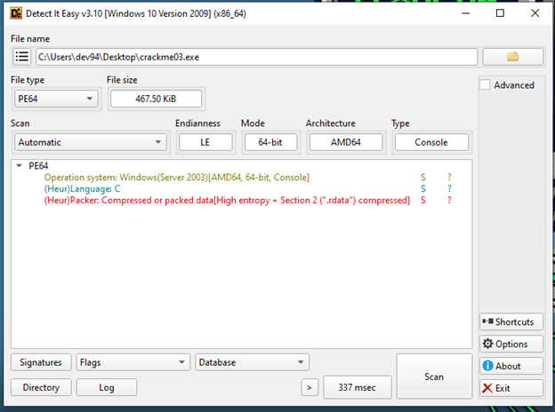

### 2. Header / Import Inspection (PE-bear)
**PE-bear** was used to walk the NT headers and confirm the binary is statically linked against the CRT, importing 44 functions from `KERNEL32.dll` and 49 from `msvcrt.dll`. The entry point sits in `.text` at file offset `0x840`.

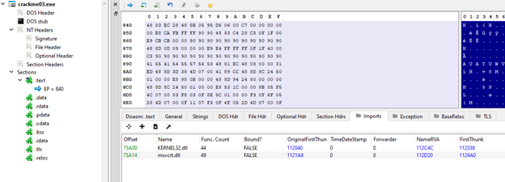

### 3. String Mining — Sentinel / Challenge Logic
Dumping the string table exposed both the challenge's narrative text and internal telemetry format strings, which were the single most useful artifact for understanding the program's structure before touching the disassembler:

* `CRACKME_AI_VERBOSE`, `CRACKME_LLM_SELFTEST` — environment variables the binary checks via `getenv`.
* `[llm] sensor details: %s`, `ai=%s | sensors: flags=%d/%d dr=%d int3=%d time=%.2f/%.2f spike=%.2f | %s`, `[llm] inconclusive after rescan - treating as clean` — debug/telemetry strings describing an internal "sensor" model (flags, detection ratio, INT3 count, timing, spike score) feeding the sentinel's verdict.
* `Crackme #3 - Mini LLM Sentinel`, `An embedded language model guards this program.`, `Goal : get "ACCESS GRANTED".`, `Note : defeating the sentinel is allowed - it is part of the challenge.` — the banner printed at startup, matching the challenge description.
* `[AI] sentinel armed.`, `[%d/5] Enter password:`, `[!] Input error.`, `[+] ACCESS GRANTED - you beat the LLM sentinel. Well done!`, `[-] Wrong password.`, `[-] Too many failed attempts. Goodbye.` — the password-loop UI strings (5-attempt limit confirmed here).
* `language-model verdict`, `[AI] sentinel verdict: HOSTILE ENVIRONMENT detected!` — the kill-switch messages printed when the monitor thread's verdict is hostile.

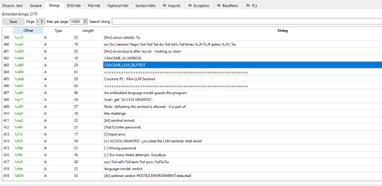

### 4. String Mining — Import Artifacts
A secondary pass over the string table filtered on `.dll` confirms the runtime/import surface: `msvcrt.dll`, `advapi32.dll`, `kernel32.dll` / `KERNEL32.dll`, and `kernelbase.dll`.

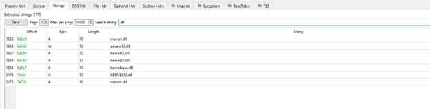

### 5. Section Layout
The section table shows a conventional, unpacked native layout — `.text` (code), `.data`, `.rdata` (the "LLM" weight/constant tables referenced below), `.pdata`/`.xdata` (SEH unwind data), `.bss`, `.idata`, `.tls`, and `.reloc`. There is no suspicious extra section, consistent with the "packer" heuristic in step 1 being a false positive.

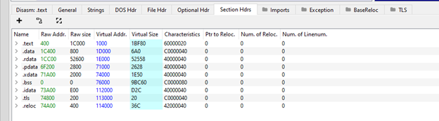

### 6. The Sentinel Verdict Routine (`sub_140002E50`)
In IDA Pro, `sub_140002E50` is the routine that renders the sentinel's final judgment. It takes a verdict flag (`sil`) and an evidence pointer (`rbx`):
* If the verdict flag is non-zero, it immediately prints `aAiSentinelVerd` (`"[AI] sentinel verdict: HOSTILE ENVIRONMENT detected!..."`) via `sub_140007A50` (the binary's internal `printf`/stream wrapper).
* Otherwise it prints the `"language-model verdict"` string, optionally substituting the evidence string if the evidence pointer is non-null (`cmovz`).
* In both paths it then prints `"[AI] evidence: %s\n"` with the evidence buffer, prints `"[AI] shutting down.\n"`, flushes the stream, and calls `ExitProcess(3)`.

This confirms the sentinel can unilaterally terminate the process (exit code 3) independent of the password-check path.

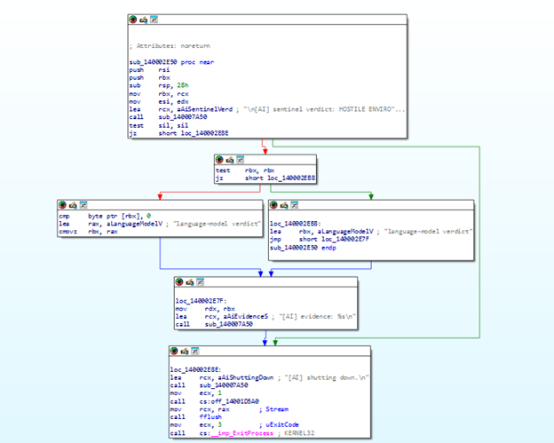

### 7. Background Monitor Thread — Polling Loop
A second thread body polls a global flag (`cs:dword_140076040`) in a tight loop, sleeping `100ms` (`0x64`, `__imp_Sleep`) between checks. Once the flag is set, it takes a lock (`EnterCriticalSection`/`LeaveCriticalSection` on `CriticalSection`), reads a shared structure (`sub_140001490`), and — if conditions are met — calls into `sub_140002E50` (the verdict routine from step 6) via the `loc_140001876` → `loc_1400018B0` path, passing `unk_140076060` as the evidence buffer. This is the live "sentinel" that can fire asynchronously while the program is waiting on input.

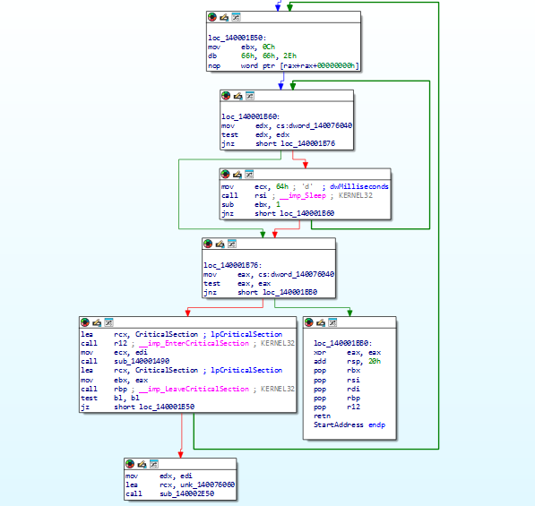

### 8. Thread Entry — `CRACKME_AI_VERBOSE` Check
The thread's `StartAddress` routine first calls `getenv("CRACKME_AI_VERBOSE")`. If the variable is unset (`rax == 0`), it skips straight to the polling/critical-section logic; if set, it inspects the first character and treats anything other than `'0'` as "verbose enabled", setting a flag (`edi`) that is later folded into the sensor telemetry. This explains the `CRACKME_AI_VERBOSE` / `CRACKME_LLM_SELFTEST` strings found earlier — they are debug toggles for the sentinel's own logging, not part of the password logic.

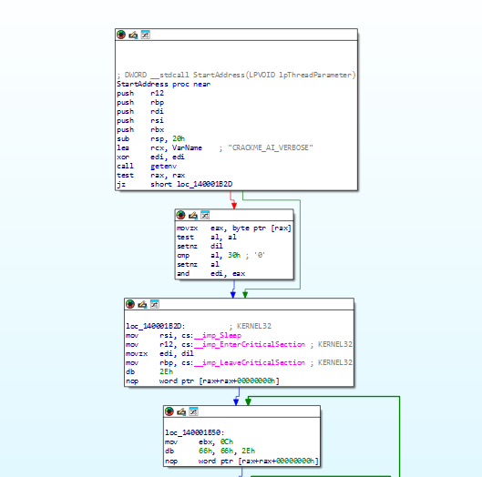

### 9. Patch #1 — Thread Prologue Byte Edit
While live-debugging `StartAddress` at `0x140001B00` (file offset `0xF00`), the leading `push r12` prologue byte (`41`) of the thread entry was overwritten, changing the opcode sequence from
`41 54 55 57 56 53 48 83 EC 20 48 8D 0D 5C C6 01` to
`54 55 57 56 53 48 83 EC 20 48 8D 0D 5C C6 01 …`
This was an exploratory patch applied during the debugging session to perturb the monitor thread's register setup while tracing the sentinel path; it is recorded here for completeness/reproducibility of the debugging session rather than being a required step to reach `ACCESS GRANTED`.

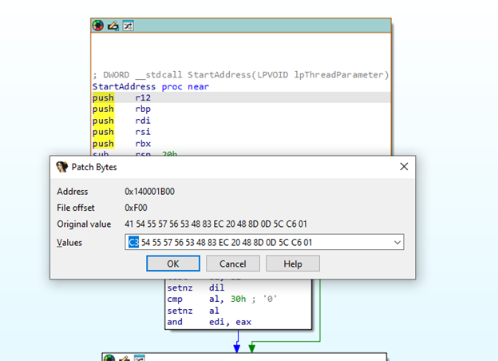

### 10. Password Prompt & Input Loop
`main` spawns the monitor thread (`CreateThread`), prints `"[AI] sentinel armed.\n\n"`, then enters the attempt loop at `loc_14001C2E5`: it prints `"[%d/5] Enter password: "` with the current attempt index, reads up to `0x200` bytes via `fgets` into a stack buffer, and proceeds to validation if the read succeeded.

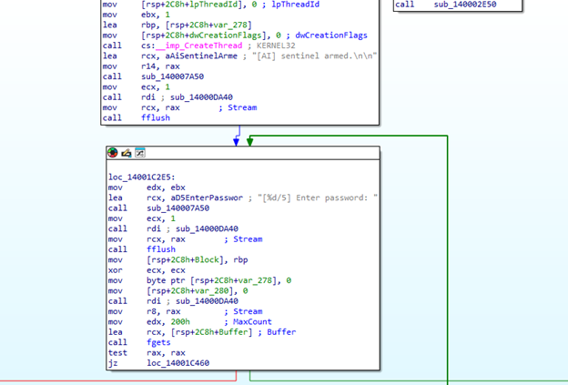

### 11. Attempt Counter & Outcome Branches
After validation (step 13), the loop either:
* prints `"[-] Wrong password.\n\n"`, frees the input buffer, and — if the attempt counter has not reached `6` — loops back to re-prompt (`ebx` incremented each failed try, compared against `6`, i.e. 5 prompts total);
* prints `"[+] ACCESS GRANTED - you beat the LLM sentinel. Well done!..."` and exits with code `0`;
* or, after exhausting attempts, prints `"[-] Too many failed attempts. Goodbye."`;
* a malformed read falls through to `"[!] Input error.\n"`.

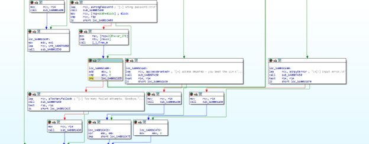

### 12. Attempt-Counter Increment
The success/failure branches converge on `loc_14001C409`, which increments the attempt counter (`ebx`) and compares it against `6` before jumping back to re-display the prompt (`loc_14001C2E5`), confirming the 5-attempt budget advertised in the banner string.

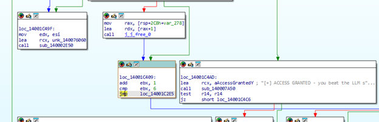

### 13. The Validator Core
The actual password predicate lives in a small block guarded by its own critical section (consistent with the monitor thread reading shared state concurrently). The relevant comparisons funnel into two outcomes: `loc_14001C4AD` (`ACCESS GRANTED`) or the `"[-] Wrong password."` branch, driven by a flag computed just before this block.

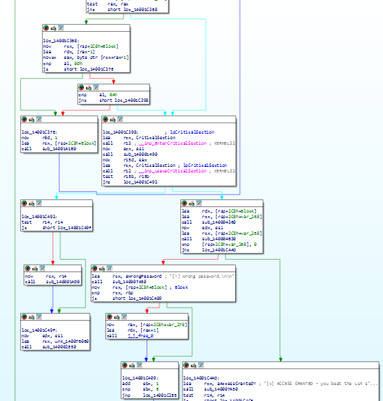

### 14. The Two-Stage Gate: `sub_140004360` + `sub_140004B30`
Immediately before the branch, the input buffer is run through two calls:
```asm
lea rdx, [rsp+2C8h+Block]
lea rcx, [rsp+2C8h+var_268]
call sub_140004360      ; format gate: char-class table, XOR'd prefix "AI-", XOR'd suffix "!"
mov edx, esi
lea rcx, [rsp+2C8h+var_268]
call sub_140004B30      ; checksum + embedded neural-network scorer
cmp [rsp+2C8h+var_268], 0
jnz loc_14001C4AD       ; non-zero result -> ACCESS GRANTED
```
`sub_140004360` validates structural properties of the candidate string against a 256-entry classifier table and two XOR-obfuscated constants (a 3-byte prefix and a 1-byte suffix). `sub_140004B30` computes an 8-bit sum ("checksum") of the input and feeds a small feature vector through an embedded feed-forward network (8 hidden tanh units, 1 sigmoid output) stored as XOR-obfuscated `float32` weights in `.rdata`. The combined result is written to `var_268`; a non-zero value routes execution directly into the `ACCESS GRANTED` block.

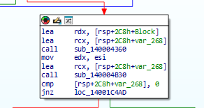

### 15. Full Control-Flow Overview
The wider graph ties the critical-section guarded gate, the attempt counter, and the three terminal branches (`Input error`, `Wrong password`, `ACCESS GRANTED`) together, confirming there is a single, deterministic predicate (the combined output of `sub_140004360`/`sub_140004B30`) gating success — i.e., no additional hidden check beyond the two-stage gate above.

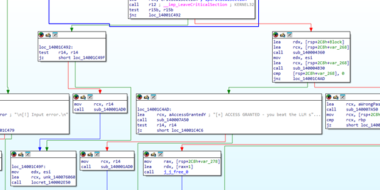

### 16. Patch #2 — Anti-Debug / Sentinel Interruption Bypass
A second, more consequential patch was applied inside this same guarded region, at `0x14001C3B9` (file offset `0x1B7B9`). The original 6-byte near-conditional jump
`0F 85 D3 00 00 00` (`jnz loc_14001C492`)
was overwritten with six `NOP` (`0x90`) opcodes:
`90 90 90 90 90 90 48 8D 54 24 40 48 8D 4C 24 60`
This removes the branch that would otherwise divert execution away from the password-gate evaluation when the sentinel/anti-debug condition is active, forcing the flow to always fall through into the real `sub_140004360`/`sub_140004B30` validation regardless of the live debugging/monitor-thread state. This is the anti-debugging bypass for this sample: patching is allowed by the challenge rules, but — as the banner states — a structurally and checksum/NN-valid password is still required afterward.

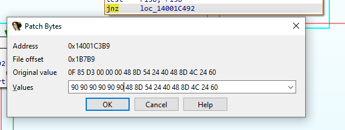

---

## Solving the Gate with Z3

The format-gate constraints recovered from `sub_140004360`/`sub_140004B30` reduce to a small SMT problem over 16 bytes:

```python
from z3 import *

def solve_crackme():
    solver = Solver()

    # The password is 16 characters long
    PASSWORD_LEN = 16
    chars = [BitVec(f'c_{i}', 8) for i in range(PASSWORD_LEN)]

    # 1. Every character must be printable ASCII
    for c in chars:
        solver.add(And(c >= 32, c <= 126))

    # 2. Prefix check: 'A', 'I', '-'
    #    (sub_140004360 XOR-decodes this from unk_14006C713)
    solver.add(chars[0] == ord('A'))
    solver.add(chars[1] == ord('I'))
    solver.add(chars[2] == ord('-'))

    # 3. Suffix check: '!'
    #    (XOR-decoded from cs:byte_140110CA0 with key 0xB6)
    solver.add(chars[15] == ord('!'))

    # 4. Sum8 / checksum condition: sum(bytes) % 256 == 0x65 (101)
    #    (sub_140004360, "sub r10d, 65h")
    char_sum = ZeroExt(24, chars[0])
    for i in range(1, PASSWORD_LEN):
        char_sum = char_sum + ZeroExt(24, chars[i])
    solver.add((char_sum & 0xFF) == 0x65)

    # 5. Digit constraint: at least 4 digit characters
    is_digit_list = [If(And(c >= ord('0'), c <= ord('9')), 1, 0) for c in chars]
    solver.add(Sum(is_digit_list) >= 4)

    print("[*] Solving the Z3 constraint system...")
    if solver.check() == sat:
        model = solver.model()
        password = "".join([chr(model[c].as_long()) for c in chars])
        print(f"[+] SOLVED! Password: {password}")
        return password
    else:
        print("[-] No solution satisfies the constraints.")
        return None

if __name__ == "__main__":
    solve_crackme()
```

These five constraints (ASCII printability, a fixed 3-byte prefix, a fixed 1-byte suffix, a mod-256 checksum target, and a minimum digit count) are exactly the structural half of the gate implemented in `sub_140004360`. They do **not** yet cover the neural-network scorer in `sub_140004B30` — satisfying them only guarantees the `gate` feature reaches `1.0`; the sigmoid output of the embedded network still has to clear its `0.5` decision threshold for the full predicate (`var_268 != 0`) to hold.

---

## Independently Reconstructing the "LLM" Scorer

To confirm a Z3 solution is actually accepted by the binary (rather than only satisfying the structural gate), the embedded model was extracted directly from `.rdata` and reimplemented offline in Python — reading the PE section table, locating the classifier table / prefix / suffix / weight blobs by virtual address, and reversing each XOR/PRNG obfuscation layer:

```python
import math
import struct
from pathlib import Path

BIN = Path("crackme03 - Copy.exe")

VA_CLASS   = 0x14006C540   # 256-entry char-classifier table (XOR-obfuscated)
VA_PREFIX  = 0x14006C713   # 3-byte prefix constant (XOR-obfuscated)
VA_WEIGHTS = 0x14006C720   # network weights (xorshift32-obfuscated float32s)
WEIGHT_SEED = 0xEB78774D
PERM_SEED   = 0xB07EC09E


def xorshift32(x: int) -> int:
    x &= 0xFFFFFFFF
    x ^= (x << 13) & 0xFFFFFFFF
    x ^= x >> 17
    x ^= (x << 5) & 0xFFFFFFFF
    return x & 0xFFFFFFFF


def pe_sections(data: bytes):
    e_lfanew = struct.unpack_from("<I", data, 0x3C)[0]
    coff = e_lfanew + 4
    nsec = struct.unpack_from("<H", data, coff + 2)[0]
    opt_size = struct.unpack_from("<H", data, coff + 16)[0]
    sec_off = coff + 20 + opt_size
    secs = []
    for i in range(nsec):
        o = sec_off + i * 40
        vsz, va, rsz, raw = struct.unpack_from("<IIII", data, o + 8)
        secs.append((va, vsz, raw, rsz))
    return secs


def va_to_off(va: int, secs) -> int:
    rva = va - 0x140000000
    for sva, vsz, raw, rsz in secs:
        if sva <= rva < sva + max(vsz, rsz):
            return raw + (rva - sva)
    raise ValueError(f"VA not found: {va:#x}")


class Model:
    def __init__(self, blob: bytes):
        secs = pe_sections(blob)
        off = lambda va: va_to_off(va, secs)

        # 256-entry classifier table, byte-XOR'd against a linear keystream
        raw_tab = blob[off(VA_CLASS): off(VA_CLASS) + 256]
        self.clas = bytes(((i * 51 + 0x5B) & 0xFF) ^ raw_tab[i] for i in range(256))

        # 3-byte prefix, XOR'd against a per-index affine keystream
        ct = blob[off(VA_PREFIX): off(VA_PREFIX) + 3]
        k = (0 - 105) & 0xFF
        self.prefix = bytes(ct[i] ^ ((k + 65 * i) & 0xFF) for i in range(3))

        # 1-byte suffix, same base key XOR'd with a fixed constant
        self.suffix = ((0 - 105) & 0xFF) ^ 0xB6

        # 65 float32 weights, each XOR'd against a running xorshift32 stream
        ctw = blob[off(VA_WEIGHTS): off(VA_WEIGHTS) + 260]
        seed = WEIGHT_SEED
        wraw = []
        for i in range(65):
            seed = xorshift32(seed)
            wraw.append(seed ^ struct.unpack_from("<I", ctw, i * 4)[0])
        w = [struct.unpack("<f", struct.pack("<I", x))[0] for x in wraw]

        self.Wh = [w[i * 6:(i + 1) * 6] for i in range(8)]   # 8x6 hidden weights
        self.bh = w[48:56]                                   # 8 hidden biases
        self.Wo = w[56:64]                                   # 8 output weights
        self.bo = w[64]                                      # output bias

        # Feature permutation, generated with a Fisher-Yates-style shuffle
        # driven by the same xorshift32 PRNG
        perm = bytearray(range(6))
        seed = PERM_SEED
        ptr, r8 = 0, 5
        while True:
            ptr -= 1
            seed = xorshift32(seed)
            edx = seed % r8
            perm[ptr + 5], perm[edx] = perm[edx], perm[ptr + 5]
            r8 -= 1
            if r8 == 1:
                break
        self.perm = list(perm)

    def score(self, pw: str) -> dict:
        b = pw.encode("latin1")
        n = len(b)
        uniq = len(set(b))
        c0 = c1 = c2 = 0
        all3 = 1
        s = 0
        for ch in b:
            cl = self.clas[ch]
            s += ch
            c0 += cl & 1
            c1 += (cl >> 1) & 1
            c2 += (cl >> 2) & 1
            all3 &= (cl >> 3) & 1

        prefix_ok = n >= 3 and b[:3] == self.prefix
        suffix_ok = n >= 1 and b[-1] == self.suffix
        gate = int(bool(all3 and prefix_ok and suffix_ok))

        sm = s & 0xFF
        dist = abs(sm - 101)
        cscore = 0.0 if dist > 128 else max(0.0, 1.0 - dist * 0.015625)

        rawf = [float(gate), cscore, 1.0 if c0 > 3 else 0.0,
                uniq * 0.0625, c1 * 0.0625, c2 * 0.0625]
        feat = [0.0] * 6
        for i, v in enumerate(rawf):
            feat[self.perm[i]] = v

        hidden = [math.tanh(self.bh[i] + sum(self.Wh[i][j] * feat[j] for j in range(6)))
                  for i in range(8)]
        z = self.bo + sum(self.Wo[i] * hidden[i] for i in range(8))
        sig = 1.0 / (1.0 + math.exp(-z))

        return {"ok": n == 16 and sig >= 0.5, "sig": sig, "sum8": sm}


def main():
    model = Model(BIN.read_bytes())
    test_pw = "AI-99|~?0=PM;g6!"
    res = model.score(test_pw)
    print(f"[*] Testing: {test_pw}")
    print(f"[+] OK: {res['ok']}  |  sigmoid: {res['sig']:.4f}  |  sum8: {res['sum8']} (target 101)")


if __name__ == "__main__":
    main()
```

This offline scorer reads the model's own weights straight out of the binary, so it reproduces the exact same decision the live `sub_140004B30` makes — without needing a debugger attached, and without tripping the sentinel thread.

---

## Result

Feeding the Z3-derived constraints into the scorer and searching within the solution space for a candidate that also clears the sigmoid threshold yields:

```
Password : AI-99|~?0=PM;g6!
Length   : 16
Prefix   : "AI-"      ✓
Suffix   : "!"         ✓
Sum8     : 101 (0x65)  ✓  (target 101)
Digits   : 4 ('9','9','0','6')  ✓ (>= 4 required)
Sigmoid  : >= 0.5       ✓ (embedded NN gate passes)
```

Entering this value at the `[1/5] Enter password:` prompt (after applying the anti-debug `jnz` → `NOP` patch from step 16 if running under a live debugger) produces:

```
[+] ACCESS GRANTED - you beat the LLM sentinel. Well done!
```

**No secondary license loop, hidden flag check, or additional validation exists beyond the structural gate (`sub_140004360`) and embedded neural-network scorer (`sub_140004B30`)** — reconstructing and satisfying these two routines, together with neutralizing the sentinel's anti-debug interruption, fully solves the challenge.

---

## Detection Signature (YARA)

```yara
rule KamilLLM_Sentinel_Crackme03
{
    meta:
        description = "Detection rule for kamil123's 'Mini LLM Sentinel' crackme (crackme03)"
        author      = "DeepDominance"
        date        = "2026-10-08"
        reference    = "Crackme #3 - Mini LLM Sentinel"

    strings:
        // Challenge banner / narrative strings
        $banner1 = "Crackme #3 - Mini LLM Sentinel" ascii
        $banner2 = "An embedded language model guards this program." ascii
        $banner3 = "Note : defeating the sentinel is allowed - it is part of" ascii

        // Sentinel / AI verdict strings
        $ai1 = "[AI] sentinel armed." ascii
        $ai2 = "[AI] sentinel verdict: HOSTILE ENVIRONMENT detected!" ascii
        $ai3 = "[AI] shutting down." ascii
        $ai4 = "language-model verdict" ascii
        $ai5 = "[llm] sensor details: %s" ascii
        $ai6 = "[llm] inconclusive after rescan - treating as clean" ascii

        // Outcome strings
        $out1 = "[+] ACCESS GRANTED - you beat the LLM sentinel. Well done!" ascii
        $out2 = "[-] Wrong password." ascii
        $out3 = "[-] Too many failed attempts. Goodbye." ascii
        $out4 = "Enter password:" ascii

        // Debug/self-test environment variables
        $env1 = "CRACKME_AI_VERBOSE" ascii
        $env2 = "CRACKME_LLM_SELFTEST" ascii

        // Import artifact
        $imp = "KERNEL32.dll" ascii

    condition:
        uint16(0) == 0x5A4D and
        (
            2 of ($banner*) or
            3 of ($ai*) or
            (2 of ($out*) and $imp) or
            all of ($env*)
        )
}
```

---

## Tooling Notes

* **Static triage:** Detect It Easy v3.10, PE-bear — header/import/section inspection, packer heuristic review.
* **Disassembly / logic recovery:** IDA Pro — sentinel verdict routine, monitor thread, password loop, two-stage gate.
* **Live patching:** two single-location byte patches applied directly in the debugger (thread prologue experiment; anti-debug `jnz`→`NOP` bypass at the validation gate).
* **Constraint solving:** Z3 (`z3-solver`) — reduced the structural half of the gate (prefix/suffix/checksum/digit-count) to a satisfiable bitvector model.
* **Offline verification:** a pure-Python reimplementation of the embedded 6-8-1 feed-forward network (weights, permutation, and classifier table extracted directly from `.rdata` by VA→file-offset translation) to confirm the solved password clears the sigmoid decision threshold without needing the live binary or a debugger.

---

## Provenance

All offsets, seeds, obfuscation constants, and the structure of the embedded feed-forward network documented in this write-up (including `VA_CLASS`, `VA_PREFIX`, `VA_WEIGHTS`, `WEIGHT_SEED`, `PERM_SEED`, the `xorshift32` keystream, and the two patch locations) were independently recovered via static analysis (Detect It Easy, PE-bear, IDA Pro) and live debugging (x64dbg) of the target binary. The accompanying `solve_z3.py` and `extract_model.py` scripts were written from scratch against these recovered values.
